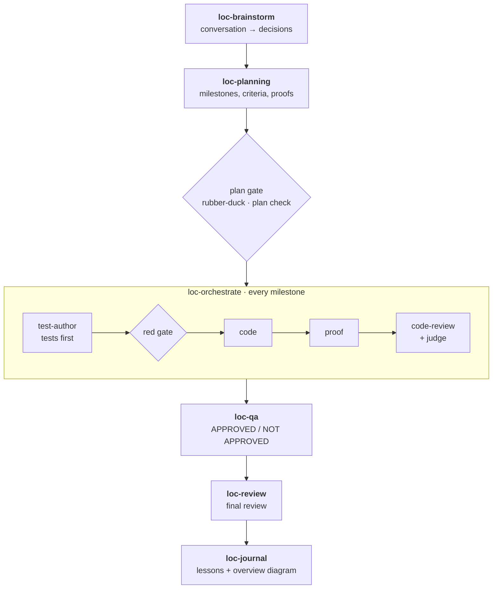

<div align="center">

# masterskills

**A project workflow for Claude Code that works like a small team.**<br>
An architect, a judge, a PM, QA and two critics take your idea from a conversation to reviewed, tested commits,<br>
and they ask you only what they cannot decide.

[](CHANGELOG.md)
[](LICENSE)
[](#install)
[](#opencode)

[Install](#install) · [How it works](#how-it-works) · [The team](#the-team) · [Compared with](#compared-with-other-skill-packs) · [Changelog](CHANGELOG.md)

</div>

---

## Why masterskills

- **Plans that can fail.** Every milestone ends with a proof: a command and its expected result. Tests come first, written by an agent that never reads the implementation, and they must fail on an assertion before any code is written.
- **Decisions without interruptions.** The `architect` settles what you need not decide. What only you can decide becomes a question file with a recommended option, and the work goes on with that option meanwhile.
- **Reviews that end.** Every gate gets at most three rounds. The `judge` weighs each finding against what the project is for (`fix`, `enough`, or `challenges D-07`), so review does not turn into polishing.
- **Memory that survives `/clear`.** Ideas, decisions, plans, open questions and lessons live in `loc/` inside your project, and every session starts with what is open.
- **Small by contract.** About 470 words of rules are always loaded; each skill loads only when it is used. Word budgets are enforced by the test suite, not promised.
- **Answers with a picture.** Ask "how does saving an entry work?" and get a diagram drawn from the code, with `file:line` on every box, kept up to date in `loc/diagrams/`.

## Install

The repository is its own plugin marketplace. In Claude Code:

```text
/plugin marketplace add etobod/masterskills
/plugin install masterskills@masterskills
```

Restart Claude Code, open your project and run:

```text
/masterskills:loc-init
```

To update later: `/plugin marketplace update masterskills`, then run `/masterskills:loc-init` again in each project. It only adds what is missing.

<details>
<summary><b>Requirements</b></summary>

- **git.** The project root must be a git repository: plans snapshot every milestone with git, reviews read the diff and work ends in a commit. `loc-init` offers to run `git init` when there is none.
- **Python 3** on `PATH` as `python3`, `python` or `py`. Hooks and skills run the plugin's helper scripts with it.
- **A POSIX `sh`.** Hooks and skills start scripts through `sh scripts/py.sh`. macOS and Linux have it. On Windows, install Git for Windows (Git Bash).

</details>

## Quick start

```text
/masterskills:loc-init                     set up loc/ and CLAUDE.md; in a new project, talk it through
/masterskills:loc-brainstorm               turn a conversation into numbered decisions
/masterskills:loc-planning 001             make a plan from brainstorm 001
/masterskills:loc-orchestrate 002          execute plan 002, milestone by milestone
/masterskills:loc-director until 21:00     or let the team run a course on its own
```

## How it works



Everything the workflow writes stays in `loc/`, ignored by git with one line:

| Path | What it holds |
|---|---|
| `loc/inbox/` | open work: brainstorms, plans, questions for you, deferred and stuck items |
| `loc/PRD.md` | what the project is for, its decisions (`D-01`…) and directions |
| `loc/TEST-PLAN.md` | the project's test contract: layers, commands, what to extend |
| `loc/PATTERNS.md` | commands that failed and what worked instead |
| `loc/MEMORY.md` | lessons from finished work |
| `loc/diagrams/` | the project overview and the diagrams you keep |

## The team

Agents are spawned with a clean context and narrow tools, so each one judges only what it is given.

| | Role | Agent | What it does | Limits |
|---|---|---|---|---|
| 🏛️ | **Architect** | `architect` | Decides what you need not: settles a choice a skill would ask you, challenges recorded decisions, decides what follows a stuck gate, proposes decisions from finished plans | read-only |
| ⚖️ | **Judge** | `judge` | Weighs every review finding against the project's goal: `fix`, `enough` or `challenges D-NN`, each with a reason | read-only, adds no findings |
| 📋 | **PM** | `pm` | Orders open plans and deferred, stuck and review work into one queue, so a plan is not first only because it is new | read-only |
| 🦆 | **Rubber duck** | `rubber-duck` | Independent critic of a plan or a change: are all requirements covered, can every proof really fail | read-only |
| 🧪 | **QA** | `qa` | Runs the suite once, compares the tests with the plan's starting copy (a weakened test is caught), writes what is missing, gives the verdict | edits tests only |
| ✍️ | **Test author** | `test-author` | Writes tests from a milestone's behaviour criteria before the code exists | writes tests only, never reads the code |
| 🔎 | **Researcher** | `researcher` | Maps what exists before a change: files, call sites, tests, commands, with `file:line` | documents, never judges |
| 🔍 | **Code reviewer** | `code-review` | Reviews the diff of every milestone and the final change | read-only |

In Claude Code the code reviewer is its built-in `code-review` skill; the OpenCode build ships it as an agent.

## Skills

| Skill | Use it to |
|---|---|
| `loc-init` | set up or update `loc/` and `CLAUDE.md`; fill the project's goal from a brainstorm |
| `loc-brainstorm` | keep the notes and decisions of a design conversation in one file |
| `loc-planning` | turn a brainstorm into plans whose milestones have criteria, tests and proofs |
| `loc-orchestrate` | execute a plan: tests first, code, proof, review, commit |
| `loc-qa` | get a QA verdict on a plan or a change, at any time |
| `loc-review` | review a diff at the level you choose |
| `loc-journal` | record what was learned after work outside a plan |
| `loc-diagram` | see how something works, drawn from the code |
| `loc-debug` | fix a reported bug: reproduce it, pin it with a failing test, find the cause before changing code |
| `loc-director` | run an agreed course ("until plan 087 is done", "until 21:00") without you |

## Compared with other skill packs

Each project is described from its own README. We have not run a head-to-head benchmark.

| Project | What it is | Choose it when |
|---|---|---|
| **masterskills** | A project workflow run by a team of narrow agents, with state kept in `loc/` | you want plans executed, tested and reviewed across many sessions with few interruptions |
| [obra/superpowers](https://github.com/obra/superpowers) | A full methodology: brainstorming, git worktrees, plans, subagent-driven development, enforced TDD, code review, finishing a branch | you want one opinionated process from idea to merged branch |
| [mattpocock/skills](https://github.com/mattpocock/skills) | Small skills you compose yourself (`grill-me`, `tdd`, `to-spec`…) | you want single procedures, not a process |
| [Fission-AI/OpenSpec](https://github.com/Fission-AI/OpenSpec) | Spec-driven development: every change gets a folder with a proposal, specs, design and tasks; works with many assistants | a team shares specs across tools and repositories |
| [microsoft/hve-core](https://github.com/microsoft/hve-core) | An agentic SDLC framework: research, plan, implement and review agents, instructions for coding standards | you work in VS Code with GitHub Copilot |

### masterskills and Superpowers

Both cover the road from an idea through a plan and test-driven development to review. masterskills is built to walk it with less context, fewer interruptions and loops that end:

| | masterskills |
|---|---|
| **Context** | ~470 words of rules always loaded; a skill loads only when used. Budgets are checked by the test suite: a skill core ≤ 800 words, an agent ≤ 500 |
| **Interruptions** | The `architect` decides what you need not; your questions wait in files with a recommended option while work continues; `loc-director` runs a course overnight |
| **Review loops** | At most three rounds per gate, then recorded and carried on; the `judge` stops fixes the project does not need |
| **Tests you can trust** | A red gate that must fail on an assertion; tests written blind by `test-author`; QA compares the final tests with the plan's starting copy |
| **Across sessions** | Plans, decisions, questions and lessons in `loc/`; the open inbox is injected at every session start, `/clear` and compaction |
| **Project knowledge** | Project facts live in your `CLAUDE.md` and `loc/PRD.md`, never in the skills, so the skills stay the same in every project |
| **Understanding the code** | Diagrams drawn from the code with `file:line`, refreshed after every plan |
| **Other tools** | The same skills build for OpenCode |

## Frontend projects

Tests prove that a page works, not that it looks good. masterskills does not ship its own design rules; it works with a design plugin installed beside it and is told about it in a `## Frontend` section of your `CLAUDE.md`:

```markdown
## Frontend
Design plugin: impeccable. Design review: its critique command.
UI check: <the plugin's detector command>, fails on a finding.
Screenshots: npx playwright test tests/screens, widths 375, 768, 1440.
```

With that section filled:

- **brainstorms** record a visual direction for every new screen as a decision;
- **plans** run the UI check in the proof of every milestone that changes what the user sees, and leave only the look to a manual check;
- **`loc-qa`** runs the UI check and the screenshot layer of `loc/TEST-PLAN.md` like any other gate;
- **`loc-review`** runs the design review beside `rubber-duck` and `code-review`, and its findings go through the `judge` like the rest.

We suggest [pbakaus/impeccable](https://github.com/pbakaus/impeccable): its slop detector is deterministic, so a UI check can really fail. [Leonxlnx/taste-skill](https://github.com/Leonxlnx/taste-skill) is an alternative when you want art direction and browser checks at three widths. An empty `## Frontend` means the project has no user interface, and nothing changes.

## Guards

Hooks apply wherever the plugin is enabled:

- **The skills' own commands run without a prompt.** A `Bash` command that is exactly one of the plugin's scripts, `date +<format>`, a move of one file from `loc/inbox/` to `loc/inbox/done/`, or the CI status check is allowed, and so are reads inside the plugin's own directory. Anything with `;`, `&&`, a pipe, a redirection or a `$` goes through the normal permission rules.
- **Writes stay in the project.** `Write`, `Edit` and `NotebookEdit` outside the project directory are denied. For `Bash` and `PowerShell`, redirections, `tee` and the common PowerShell write cmdlets are checked.
- **One CI check after a push.** In a project with `.github/workflows/`, the latest GitHub Actions run is checked once; a failed run becomes a `stuck` inbox file.
- **No AI attribution in commits.** A `git commit` carrying a `Co-authored-by` line for Claude, "Generated with Claude Code", a session link or the Anthropic no-reply address is denied.

A deny from a guard wins over an allow. A managed setting that allows only managed hooks (`allowManagedHooksOnly`) turns these off.

## OpenCode

`opencode/build.py` translates the plugin for [OpenCode](https://opencode.ai) at install time: skills, a command per skill, agents with permissions, and the hooks as an OpenCode plugin. On Windows, clone the repository and run `opencode-install.bat`; elsewhere run `python opencode/build.py --install`. Restart OpenCode afterwards.

## License

[MIT](LICENSE)
